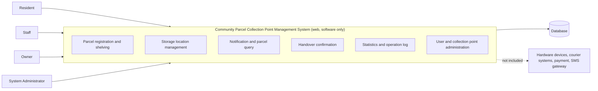

# Software Requirements Specification (SRS)

## Community Parcel Collection Point Management System

| Item | Detail |
|---|---|
| Document ID | SRS |
| Task | T-10-05 |
| Version | v0.2 (draft, Chapters 1 to 3) |
| Author | R2 |
| Status | Draft, pending team review |
| Related documents | [personas.md](../elicitation/Personas.md), [user-journey-maps.md](../elicitation/user-journey-maps.md) |

## Table of Contents

- [1. Introduction](#1-introduction)
- [2. Overall Description](#2-overall-description)
- [3. Functional Requirements](#3-functional-requirements)
---

## 1. Introduction

### 1.1 Purpose

This document specifies the software requirements for the Community Parcel Collection Point Management System. It is intended for the project team, the course instructor, and future testers. Chapters 1 and 2 define the background, problem, goals, scope, and overall context. Later chapters (functional requirements, non-functional requirements, and so on) will be added in later weeks.

### 1.2 Background

Online shopping has made parcel delivery a daily activity in residential communities. Couriers often deliver parcels in bulk to a nearby **collection point** (for example, a convenience store or a community service room), where staff keep the parcels until residents pick them up. Requirements were elicited through four questionnaires, one per user role; the elicitation method and its limits are recorded in `docs/01-requirements/elicitation/survey-results.md`.

Many small collection points still rely on manual registration, paper notebooks, and informal communication. As parcel volume grows, this causes errors, delays, and disputes.

### 1.3 Problem Statement

| # | Problem | Affected role |
|---|---|---|
| P1 | Residents do not receive timely or clear notification of arrival and cannot tell where their parcel is. | Resident |
| P2 | Queues and long waits at the collection point during peak hours. | Resident, Staff |
| P3 | Manual registration and shelving of large batches is slow and error-prone. | Staff |
| P4 | Searching for a parcel on crowded shelves wastes time. | Staff, Resident |
| P5 | Wrong-person handovers and unprovable lost-parcel claims, because there is no reliable handling record. | All roles |
| P6 | The owner has no real-time statistics on volume, overdue parcels, or staff activity. | Owner |

### 1.4 Goals

| ID | Goal |
|---|---|
| G1 | Give residents timely visibility of their parcels, including status, storage location, and pickup code. |
| G2 | Reduce the time staff need for **shelving** and **handover** compared with the manual process. |
| G3 | Keep an accurate, traceable record of every parcel from arrival to handover. |
| G4 | Provide the owner with simple statistics and overdue-parcel monitoring. |
| G5 | Provide role-based access so each user only sees what they need. |
| G6 | Deliver a usable web system within the eight-week project schedule (week 1 to week 8). |

> Quantified targets (for example, handover time and notification delay) are derived from the questionnaire and recorded in `survey-results.md` section 7; they are specified in the non-functional requirements chapter.

### 1.5 Scope

#### 1.5.1 Important clarification

> **This system is a pure-software web system and does not involve any hardware device control.**

#### 1.5.2 In Scope

| ID | Item |
|---|---|
| IS-1 | User registration, login, and role-based access control for four roles. |
| IS-2 | Registration of incoming parcels (single and batch) at a collection point. |
| IS-3 | **Shelving** workflow: assigning each parcel to a **storage location** and recording it. |
| IS-4 | Management of storage locations (create, edit, disable). |
| IS-5 | Notification to residents when a parcel is shelved (in-system notification). |
| IS-6 | Parcel query and status tracking for residents and staff. |
| IS-7 | **Handover** workflow: verifying a pickup code or identity and confirming handover. |
| IS-8 | Handling of exceptions: overdue, damaged, wrong-recipient, refused or lost parcels. |
| IS-9 | Operation log for every parcel and staff action. |
| IS-10 | Statistics and overdue-parcel reports for owners. |
| IS-11 | Collection point and staff account management. |
| IS-12 | System administration (users, collection points, basic configuration). |

#### 1.5.3 Out of Scope

| ID | Item | Reason |
|---|---|---|
| OS-1 | Control of any hardware device, including scanners, printers, door access, or any other physical equipment. | The system is software only. |
| OS-2 | Courier and logistics functions such as route planning, dispatching, and delivery tracking before arrival at the collection point. | Handled by courier companies. |
| OS-3 | Online payment and settlement of handling fees through the system. Overdue fee *calculation* is in scope (see the retention period and overdue fee definitions in the glossary); taking payment is not. | Beyond the course timeline. |
| OS-4 | Native mobile apps for iOS or Android. | The system is a web application only (responsive browser access). |
| OS-5 | Integration with real third-party courier or e-commerce systems. | Only simulated or manually entered data is used. |
| OS-6 | Real SMS or telecom gateway integration. | Notifications are in-system only in this version. |
| OS-7 | Advanced analytics and AI-based forecasting. The storage location *suggestion* remains in scope as a deterministic rule set that staff may ignore; it is not predictive and never applied automatically. | Beyond the course timeline. |

### 1.6 Definitions, Acronyms, and Terminology

The following project terms must be used consistently in all documents and code.

| Term | Definition |
|---|---|
| Collection point | A physical place where parcels are received, kept, and handed over to residents. |
| Storage location | A specific shelf position at a collection point where a parcel is placed. |
| Shelving | The process of receiving a parcel, registering it, and placing it at a storage location. |
| Handover | The process of confirming that a parcel has been delivered to the correct resident. |
| Parcel | An item sent to a resident that is held at a collection point. |
| Pickup code | A code given to the resident, used to verify the handover. |
| SRS | Software Requirements Specification. |

### 1.7 References

| Ref | Document |
|---|---|
| [R1] | Course brief and Week 1 announcements, 3500SEF Group 23 |
| [R2] | Personas (`docs/01-requirements/elicitation/Personas.md`) |
| [R3] | User Journey Maps (`docs/01-requirements/elicitation/user-journey-maps.md`) |
| [R4] | Requirements elicitation records: questionnaires and analysis (`docs/01-requirements/elicitation/survey-results.md`, by R2 and R3) |
| [R5] | IEEE Std 830 / ISO/IEC/IEEE 29148, used as SRS structure guidance |

---

## 2. Overall Description

### 2.1 Product Perspective

The system is a new, standalone web application. It does not replace any existing system and does not depend on external platforms in this version. Users access it through a modern web browser on desktop or mobile.

### 2.2 Product Functions (Summary)

| Function area | Summary |
|---|---|
| Account and access | Registration, login, role-based permissions |
| Parcel registration | Single and batch registration of incoming parcels |
| Shelving | Assign parcels to storage locations and update status |
| Notification | Notify residents when parcels are ready |
| Search and tracking | Find parcels by code, phone number, or status |
| Handover | Verify code or identity and confirm handover |
| Exception handling | Manage overdue, damaged, wrong-recipient, refused and lost parcels |
| Reporting | Volume statistics and overdue-parcel lists |
| Audit | Operation log of all parcel-related actions |
| Administration | Manage collection points, staff, and configuration |

Detailed functional requirements will be written in Chapter 3.

### 2.3 User Roles

The system has four user roles.

| Role | Description | Persona | Main permissions |
|---|---|---|---|
| Resident | A person living near a collection point who receives parcels. | Resident persona | View own parcels, status, storage location, and pickup code; receive notifications. |
| Staff | An employee who handles parcels at a collection point. | Staff persona | Register parcels, perform shelving, search parcels, confirm handover, handle exceptions. |
| Owner | The person responsible for one or more collection points. | Owner persona | View statistics and overdue parcels, review operation logs, manage staff accounts for own collection points. |
| System Administrator | A technical user who maintains the system. | System administrator persona | Manage all users, collection points, and system configuration; review the operation log for all points. |

> The personas are **illustrative composites built from the four role questionnaires, not real
> individuals**. They carry no personal name: the questionnaire did not ask for one, and the
> ethics statement requires that no respondent be named in any project document. Each persona
> combines the answer patterns of its role group. The actor names used in the use case and
> sequence diagrams are these same four role identifiers. See
> `docs/01-requirements/elicitation/Personas.md`.

### 2.4 System Boundary

| Boundary element | Inside the system | Outside the system |
|---|---|---|
| Users | The four roles above interact via a web browser | Couriers have no direct system role in this version |
| Data | Parcel, storage location, user, and log data stored in the system database | Data in courier or e-commerce platforms |
| Devices | Standard user devices running a web browser | **Any hardware device control** (the system is pure software) |
| Services | In-system notifications | Payment, SMS, and third-party integrations |

### 2.5 Operating Environment

| Item | Description |
|---|---|
| Client | Current versions of Chrome, Edge, Firefox, and Safari on desktop and mobile |
| Server | Web server and relational database (final technology stack to be decided by the team) |
| Network | Internet or local network access is required |
| Repository | GitHub, with CI pipeline set up by R10 |

### 2.6 Design and Implementation Constraints

- The project runs for eight weeks (week 1 to week 8) and is delivered in five sprints. The course itself runs for sixteen weeks; the in-class progress review falls in weeks 10 to 12 and the final report and logbook deadline is 2026-12-08.
- The system is a web application only; no hardware device control is allowed.
- All documents and code must follow the project terminology in Section 1.6.
- All work must follow the team's GitHub workflow in `CONTRIBUTING.md` (feature branches, pull requests into `develop`, review before merge).
- User data must be handled according to basic privacy practices, for example by not storing unnecessary personal information.

### 2.7 Assumptions and Dependencies

| ID | Assumption or dependency |
|---|---|
| A1 | Staff enter or import parcel data manually because no real courier integration exists. |
| A2 | Each resident has a phone number or account that can be used to identify them. |
| A3 | Staff and residents have access to a device with a web browser and an internet connection. |
| A4 | The personas are composites built from the four role questionnaires, and the journey maps are derived from them. Both trace to `survey-results.md`; neither is a real individual. |
| A5 | The technology stack and deployment environment will be agreed by the team in a later week. |

### 2.8 Open Issues (To Be Resolved with R3)

| ID | Issue |
|---|---|
| OI-1 | Confirm the most common identification method for handover (pickup code, phone number, or both), using the prototype confirmation session (T-10-13); the questionnaires did not ask. |
| OI-2 | Confirm whether owners also need to act as staff in small collection points. |
| OI-3 | Confirm overdue-parcel rules (number of days, handling method) with real collection point owners. |

## 3. Functional Requirements

**Task:** T-10-06 · **Related issue:** #76 · **Status:** Draft for team review (R2 approval pending) · **Contribution:** R3

This draft identifies **47 functional requirements** grouped by the four agreed login roles. Each row records a stable proposed requirement identifier, one verifiable statement, rationale, source evidence or change record, MoSCoW priority and a proposed verification method. Where survey evidence does not independently support a behavior, the supporting SRS scope, design artifact, test-plan reference or CR is named instead. No synthetic interview or simulated dataset is used as empirical evidence.

### 3.0 Requirement conventions and numbering

The planned 47 functional requirements are grouped as follows: Resident `FR-1–FR-10`, Staff `FR-11–FR-25`, Owner `FR-26–FR-39`, and System administrator `FR-40–FR-47`. **Route A (proposed)** preserves known meanings for `FR-6`, `FR-9`, `FR-10`, `FR-17`, `FR-18`, `FR-19`, `FR-20`, and `FR-39` because they are already referenced in the test plan or change log. This numbering allocation is proposed for R2 approval and is **not yet frozen**.

Requirement statements use *shall* for testable required behavior and *should* for lower-priority proposals. The MoSCoW column uses a consistent format: `Must (proposed)`, `Should (proposed)`, `Must (approved — CR-003)`, `Should (approved — CR-004)`, and `Should not have (deferred — CR-005)`. All proposed priorities require R2 confirmation; approvals and deferrals refer to the cited change records. FR-8, FR-33, and FR-39 require specific scope or API confirmation as noted in their sources and verification methods.

Only the role-based persona identifiers are used: **Resident persona**, **Staff persona**, **Owner persona**, **System administrator persona**. Parcel lifecycle values are `registered`, `shelved`, and `collected`. The approved exception types are `overdue`, `damaged`, `wrong_recipient`, `refused`, and `lost`; exception records have a separate `open → processing → resolved` lifecycle. See `docs/glossary.md`.

**Scope boundaries:** No hardware control, courier login, online fee payment/settlement or genuine courier integration. Any storage suggestion must be optional, ignorable by staff and never applied automatically. The administrator can view logs from all collection points, whereas an owner is restricted to points they manage.

### 3.1 Resident persona — 10 requirements

| ID | Requirement statement | Rationale | Source | MoSCoW | Verification method |
|---|---|---|---|---|---|
| FR-1 | The system shall allow a registered resident to sign in through the web application. | Provides the resident with authenticated access to personal parcel information. | SRS IS-1; frontend-page-map `/login` | Must (proposed) | Authentication test: resident can sign in with valid credentials. |
| FR-2 | The system shall display only parcels associated with the authenticated resident in the resident parcel list. | Prevents residents from seeing other people's parcel records. | R5: parcel status 3/11; CR-013; SRS IS-6 | Must (proposed) | Access-control test: no other resident’s parcel appears in list. |
| FR-3 | The system shall allow a resident to open a detail view for one of their own parcels. | Supports self-service lookup of a single delivery. | R5: status 3/11; frontend-page-map `/my-parcels/:id` | Must (proposed) | UI/API test: own parcel detail accessible; other resident’s denied. |
| FR-4 | The system shall display the current approved lifecycle status for each parcel shown to its resident. | Provides visibility without introducing courier-only statuses. | R5: status 3/11; CR-006 | Must (proposed) | Status test: displayed value matches persisted parcel state. |
| FR-5 | The system shall display the assigned storage location of a shelved parcel to its resident. | Helps locate parcels; visibility was a recurring concern. | R3: location-related problems 5/11; R5: location 2/11 | Must (proposed) | Integration test: displayed shelf matches assigned location. |
| FR-6 | The system shall create an in-system arrival notification when a parcel is shelved. | Aligns with existing notification tests and primary resident need. | R3: late notification 4/11; R4: 9/11 within 1 hour; test-plan §6 | Must (proposed) | Integration test: shelving triggers one in-system arrival notification. |
| FR-7 | The system shall allow a resident to view their own in-system arrival notifications. | Makes notifications accessible without a telecom integration. | R5: notification 4/11; SRS IS-5; OS-6 | Must (proposed) | UI test: signed-in resident can access only own notifications. |
| FR-8 | The system shall allow a resident to retrieve the pickup code for one of their own parcels through an authenticated detail action. | Limits exposure of a sensitive pickup credential. | R5: pickup code 2/11; CR-013 (proposed; confirm R2/R6) | Must (proposed) | Authorization test: pickup code returned only to owning resident. |
| FR-9 | [Future work] The system should allow a resident to issue a time-limited delegated collection authorization. | Documents a considered feature without committing it to the current release. | R5: delegated code 0/11; CR-005 | Should not have (deferred — CR-005) | Deferred: no current-release acceptance test (CR-005). |
| FR-10 | [Future work] The system should allow a resident to revoke an unused delegated collection authorization. | Describes a potential safety mechanism for later implementation. | R5: delegated code 0/11; CR-005 | Should not have (deferred — CR-005) | Deferred: no current-release acceptance test (CR-005). |

### 3.2 Staff persona — 15 requirements

| ID | Requirement statement | Rationale | Source | MoSCoW | Verification method |
|---|---|---|---|---|---|
| FR-11 | The system shall allow an authenticated staff member to view a list of parcels belonging to their assigned collection point. | Enables the operational parcel workspace without cross-point exposure. | SRS §2.3; frontend-page-map `/parcels`; A5 (3/4), directional | Must (proposed) | Role-scope query test: staff list contains assigned-point parcels only. |
| FR-12 | The system shall allow an authenticated staff member to register a single arriving parcel at their assigned collection point. | Supports basic manual intake without courier integration. | S2 (3/7 spreadsheets, 2/7 software); SRS IS-2 | Must (proposed) | API integration test: staff can register one valid parcel. |
| FR-13 | The system shall allow an authenticated staff member to view the handling history of a parcel belonging to their assigned collection point. | Provides a traceable record for operational disputes. | S4 (3/7 handover confirmation); CR-007; frontend-page-map `/parcels/:id` | Must (proposed) | Parcel history integration test: events displayed for eligible parcel. |
| FR-14 | The system shall allow staff to record a parcel's assigned storage location when shelving the parcel. | Supports accurate shelf placement. | SRS IS-3; CR-006; frontend-page-map `/locations` | Must (proposed) | Shelving test: saved parcel location matches staff selection. |
| FR-15 | The system shall display the current availability status of storage locations at a staff member's assigned collection point. | Allows manual selection of an appropriate location. | S5 (4/7 preferred manual/no suggestion); frontend-page-map `/locations` | Must (proposed) | UI test: current location availability is displayed accurately. |
| FR-16 | The system shall allow a staff member to select a storage location manually for a parcel. | Preserves staff control over shelving. | S5 (4/7 preferred manual/no suggestion); CR-004 | Must (proposed) | Workflow test: manually chosen location persists after shelving. |
| FR-17 | The system shall reject registration of a parcel when its waybill number already exists as a parcel record. | Prevents duplicate intake records. | `test-plan.md` §6 (FR-17); SRS IS-2 | Must (proposed) | Duplicate-waybill API test: second registration rejected. |
| FR-18 | The system shall allow an authenticated staff member to register a batch of up to 50 arriving parcels in one intake operation. | Batch intake is the most frequently selected staff bottleneck and the first Sprint 2 staff feature. | **S3: 4/7**; **CR-003** | Must (approved — CR-003) | Batch intake test: up to 50 valid parcels registered in one operation. |
| FR-19 | The system should display an optional storage location suggestion for a parcel; the suggestion shall never be applied automatically. | Permits a deterministic aid without reducing staff control. | **S4: 0/7** chose it; **CR-004** | Should (approved — CR-004) | UI/integration test: suggestion shown without changing stored allocation. |
| FR-20 | The system should allow the staff member to ignore a storage location suggestion and complete shelving using a manually selected location; the suggestion shall never be applied automatically. | Makes optional recommendations explicitly overridable. | **S5: 4/7** preferred manual/no suggestion; **CR-004** | Should (approved — CR-004) | Workflow test: ignoring suggestion allows manual assignment and no automatic change. |
| FR-21 | The system shall allow staff to verify an active pickup code before a parcel handover. | Code verification is a top staff priority. | **S4: 3/7**; frontend-page-map `/pickup` | Must (proposed) | Verification test: valid active code accepted; invalid/used code rejected. |
| FR-22 | The system shall record a confirmed parcel handover with the staff operator identity obtained from the authenticated session. | Creates a reliable, attributable handover record. | **S4: 3/7**; **CR-007** | Must (proposed) | Handover integration test: operator matches authenticated session. |
| FR-23 | The system shall allow staff to register a parcel exception using exactly one of the approved types: `overdue`, `damaged`, `wrong_recipient`, `refused`, or `lost`. | Keeps exception recording deterministic and aligned with design. | **CR-010; CR-011**; SRS IS-8 | Should (proposed) | Validation test: five supported exception types accepted; unsupported type rejected. |
| FR-24 | The system shall allow staff to update an exception record only through the lifecycle `open` → `processing` → `resolved`. | Makes exception processing traceable and testable. | **CR-006; CR-010**; backend-state-machines.md | Should (proposed) | State-transition test: only permitted exception transitions are accepted. |
| FR-25 | The system shall record an audit entry whenever a staff member confirms a parcel handover. | Supports traceability of sensitive operations. | **CR-007** (operator from security context); S4 (3/7 handover record); SRS IS-9 | Must (proposed) | Audit test: confirmed handover creates a traceable operation entry. |

### 3.3 Owner persona — 14 requirements

| ID | Requirement statement | Rationale | Source | MoSCoW | Verification method |
|---|---|---|---|---|---|
| FR-26 | The system shall allow an owner to view the daily parcel summary for collection points under that owner's management. | Owner needs operational visibility across their sites. | O1: 6/7 manage multiple points; O5: reports 4/7 | Must (proposed) | Authorization test: owner dashboard covers managed points only. |
| FR-27 | The system shall allow an owner to view parcel records from collection points under that owner's management. | Provides site-scoped oversight without platform-wide privilege. | O1: 6/7 multiple points; SRS §2.3 | Must (proposed) | API test: owner cannot retrieve parcels from unowned point. |
| FR-28 | The system shall allow an owner to filter parcel records by a collection point under that owner's management. | Supports multi-point operations. | O1: 6/7 multiple points; SRS IS-10 | Must (proposed) | Filter test: selecting managed point limits parcel results. |
| FR-29 | The system shall display an overdue parcel report for collection points under the owner's management. | The overdue report is the most requested owner report. | O3: 6/7 selected overdue reports | Must (proposed) | Reporting test: only overdue parcels in owned points appear. |
| FR-30 | The system should allow an owner to compare parcel volume between collection points under that owner's management. | Responds to cross-point reporting interest. | O4: 6/7 must-have or nice-to-have | Should (proposed) | Cross-point report test: compares only managed points. |
| FR-31 | The system shall allow an owner to view the number of parcels collected at a collection point under that owner's management. | Supports routine parcel throughput monitoring. | O3: collected report 1/7; SRS IS-10 | Should (proposed) | Report test: collected count matches prepared dataset. |
| FR-32 | The system shall allow an owner to list staff accounts assigned to the owner's collection points. | Supports personnel administration without global account access. | O2: staff volume by owner; O5: staff management 2/7 | Must (proposed) | Account-list test: staff list restricted to owner-managed points. |
| FR-33 | The system shall allow an owner to assign an existing staff account to one of the owner's collection points. | Supports authorized staffing for each managed point. | O2; SRS IS-11; role boundary SRS §2.3 (API scope pending R6 review) | Should (proposed) | Authorization test: owner cannot assign staff outside managed points. |
| FR-34 | The system shall restrict an owner's parcel query results to collection points managed by that owner. | Prevents leakage across independently owned sites. | O1: 6/7 multi-point; A5: 3/4; SRS §2.3 | Must (proposed) | Negative access-control test: unowned point query denied. |
| FR-35 | The system shall allow an owner to view operation logs for collection points under that owner's management only. | Keeps owner audit access distinct from administrator access across all points. | O5: audit log 1/7; O6: 4/7 grouped by parcel/location; CR-008 | Must (proposed) | Audit access test: other owners’ point logs are excluded. |
| FR-36 | The system shall allow an owner to filter accessible operation log entries by parcel identifier. | Supports parcel-specific dispute tracing. | O6: 4/7 prefer grouping by parcel or location | Should (proposed) | Audit filter test: parcel ID returns matching authorized entries. |
| FR-37 | The system shall allow an owner to filter accessible operation log entries by storage location identifier. | Supports shelf-location-based investigation. | O6: 4/7 prefer grouping by parcel or location | Should (proposed) | Audit filter test: location ID returns matching authorized entries. |
| FR-38 | The system shall allow an owner to view the retention period applied to a collection point under that owner's management. | Allows interpretation of overdue calculations without owner-wide configuration authority. | O3: overdue 6/7; A6: retention setting 2/4 | Should (proposed) | Read-only UI test: owner sees configured retention value. |
| FR-39 | The system shall calculate an overdue fee for an eligible parcel using the configured retention period and fee rule without taking payment. | Preserves the already referenced fee-engine requirement and the online-payment exclusion. | test-plan §6 FR-39; SRS OS-3; team Week 2 task brief (fee rule pending R2/R6 review) | Should (proposed) | Fee-calculation test: compare 20 agreed boundary and rounding cases; no payment is initiated. |

### 3.4 System administrator persona — 8 requirements

| ID | Requirement statement | Rationale | Source | MoSCoW | Verification method |
|---|---|---|---|---|---|
| FR-40 | The system shall allow a system administrator to list user accounts across all collection points. | Supports platform-wide account management. | **A3: 2/4** chose user management; SRS IS-12 | Must (proposed) | Admin account-list test: records across two points are visible. |
| FR-41 | The system shall allow a system administrator to approve a pending user registration. | Reflects the preferred account-creation approach, subject to design confirmation. | **A2: 3/4** chose self-registration with approval | Should (proposed) | Registration approval workflow test: pending account can be approved. |
| FR-42 | The system shall allow a system administrator to disable a user account. | Enables platform-wide access administration. | **A3: 2/4** chose user management; SRS IS-12 | Must (proposed) | Account-management test: disabled user loses access. |
| FR-43 | The system shall allow a system administrator to create a collection point record. | Supports centralized multi-point administration. | **A3: 2/4** chose collection point management; SRS IS-12 | Must (proposed) | Point-management test: new point is persisted and retrievable. |
| FR-44 | The system shall allow a system administrator to update the basic configuration of a collection point. | Enables administrative maintenance without giving this power to owners. | **A6:** retention period 2/4; notification rules 1/4; SRS IS-12 | Should (proposed) | Configuration update test: saved admin settings are retrieved unchanged. |
| FR-45 | The system shall restrict an authenticated user to operations permitted by that user's assigned role. | Protects role boundaries throughout the platform. | **A4: 2/4** RBAC; SRS IS-1; CR-009 | Must (proposed) | Role matrix test: forbidden actions are rejected for all four roles. |
| FR-46 | The system shall associate each collection-point-scoped data record with a collection point identifier. | Supports tenant scoping in a shared database. | **A5: 3/4** shared database with site ID; ADR-002 | Must (proposed) | Data-integrity test: scoped records store valid collection point ID. |
| FR-47 | The system shall allow a system administrator to view operation log records across **all** collection points. | Implements the platform-wide audit use case, distinct from an Owner persona's logs for **their own** collection points only. | **CR-008** (UC_AdminAudit); SRS §2.3; frontend-page-map `/audit` | Must (proposed) | All-point audit test: administrator sees logs across two or more points. |

### 3.5 Numbering and approval handoff

**Selected route:** Route A — retain every FR identifier already cited by the repository and align its new definition to that citation. Identifiers preserved: `FR-6`, `FR-9`, `FR-10`, `FR-17`, `FR-18`, `FR-19`, `FR-20`, `FR-39`. The remaining role-grouped IDs are proposed and must be confirmed by R2 before the requirement baseline is frozen. The referenced NFR IDs (`NFR-1`, `NFR-4`, `NFR-5`, `NFR-6`, `NFR-7`, `NFR-10`, `NFR-12`) are reserved for Chapter 4 and are not silently renumbered here.

**Checks before approval:** R2 to confirm MoSCoW and proposed ID meanings; R6 to confirm endpoint/data-model feasibility (especially proposed CR-013 resident pickup-code access); R8 to map each Must-have to a concrete test case and confirm FR-39 fee calculation rules; R4 to confirm `FR-47` matches `UC_AdminAudit`, while Owner audit remains limited to managed points via `FR-35`.

**No current implementation promise for deferred items:** `FR-9` and `FR-10` remain future work under `CR-005`. Staff location suggestions `FR-19` and `FR-20` are optional only, may be ignored, and are **never automatically applied** (`CR-004`). Exception types follow the five approved glossary values (`CR-010` / `CR-011`); parcel lifecycle is `registered`, `shelved`, `collected` (`CR-006`). The system can calculate overdue fees (`FR-39`) but does not take online payments (`SRS OS-3`).

### 3.6 Verification approach

Verification entries indicate **proposed tests**, not tests that have already been created or executed. R8 owns final test-case ID allocation and execution status. Time and coverage targets are defined separately in Chapter 4 and the existing test plan; this chapter does not claim those tests have passed.

